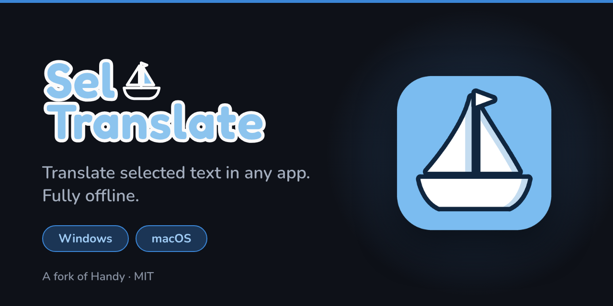
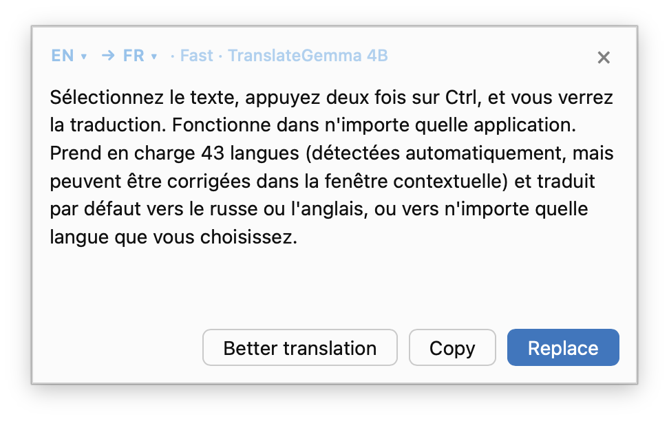
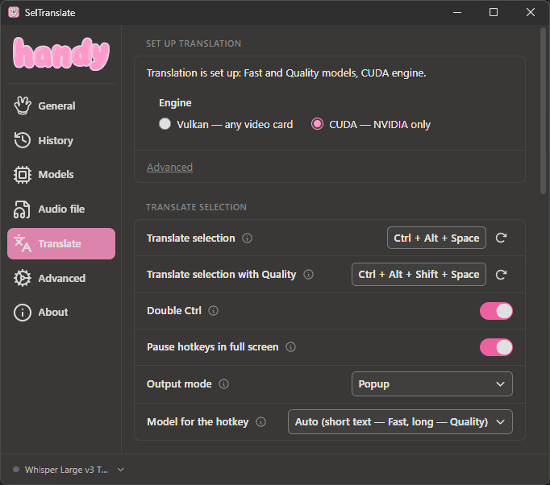
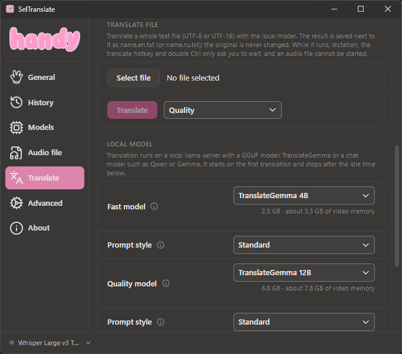

<p align="center">
  
</p>

<p align="center">
  <a href="LICENSE"></a>
  <a href="https://github.com/cjpais/Handy"></a>
  
</p>

**A fork of [Handy](https://github.com/cjpais/Handy) that adds one thing: offline, one-key translation of selected text (and of whole text files).**

## In short

- **Select text, press Ctrl twice, read the translation.** Works in any app. Reads 43 languages (detected automatically, can be corrected in the popup) and translates into Russian or English by default, or into any language you pick.
- **Dictation and file transcription come from Handy as they are.** Since Handy 0.10.0 you can drop an audio or video file into History to get its transcript.
- **Everything stays on your computer.** No account, no cloud. After the one-time download of the translation model nothing leaves your machine.

<p align="center">
  
</p>

> SelTranslate is built on top of Handy by [CJ Pais](https://github.com/cjpais), released under the MIT license. All of Handy's dictation features are still here. This README only describes what the fork adds. For the original project, see the [Handy README](https://github.com/cjpais/Handy#readme) and [handy.computer](https://handy.computer).

## What's added to Handy

### Translate selected text

Select text in any app, press the shortcut (or **double Ctrl**), and get the translation next to the selection or pasted over it. The clipboard is saved and restored.

- **Any language to any language**: the language of the text is detected automatically (43 languages) and can be corrected in the popup. By default (_Auto_) Russian goes to English and anything else to Russian; set **Target language** in the Translate settings, or pick one in the popup, to translate into any of the 43 languages.
- **Local model**: [TranslateGemma](https://huggingface.co/google/translategemma-4b-it) in GGUF format, run by a hidden `llama-server` from [llama.cpp](https://github.com/ggml-org/llama.cpp). The server starts on the first translation and stops after a period of inactivity.
- **Two model slots**: a small _Fast_ model (4B) for short phrases and a larger _Quality_ model (12B). In _Auto_ mode short texts go to Fast and long ones to Quality. A **Better translation** button in the popup repeats a translation with Quality.
- **Translate file**: translate a whole text file
- **Pause hotkeys** in the tray menu, and an option to pause them automatically while a full-screen app (a game, a video) is in the foreground.

<p align="center">
  
  
</p>

### Other changes

- Own application identifier, name, logo and icon, so SelTranslate installs next to the official Handy and is never mistaken for it.
- The auto-updater is turned off (it would replace the fork with the official build).

## Install

SelTranslate is not signed, so Windows SmartScreen and macOS Gatekeeper will warn on first launch.

| Platform                           | Package                        | Notes                                                                                            |
| ---------------------------------- | ------------------------------ | ------------------------------------------------------------------------------------------------ |
| Windows 11                         | `SelTranslate_*_x64-setup.exe` | NVIDIA cards can use the CUDA engine, other cards the Vulkan one                                 |
| macOS (Apple silicon, 15 or newer) | `SelTranslate_*_aarch64.dmg`   | Not notarized: **System Settings, Privacy & Security, Open Anyway**, and allow **Accessibility** |

Installers will be attached to the [Releases](../../releases) page.

On first start open **Translation** and use the **Set up translation** card. It downloads the llama.cpp engine and the models (about 2.3 GB for Fast and 6.8 GB for Quality, after you accept the Gemma Terms of Use). You can also point the settings at your own `llama-server` and GGUF files.

## Build from source

Same as Handy: Rust, [Bun](https://bun.sh), CMake, and the Tauri prerequisites. See [BUILD.md](BUILD.md).

```bash
bun install
bun run tauri dev      # development
bun run tauri build    # installer
```

## Where the code lives

To keep merging Handy's updates easy, the additions sit in their own modules: `src-tauri/src/translate/` (translation, llama-server, setup) and the components under `src/components/settings/translate/`. Existing Handy files are touched only to register them.

## Say thanks

SelTranslate is free. If it helped you, you can leave the author a small tip on [Lava Top](https://app.lava.top/seqvo). The original dictation app is made by CJ Pais, and you can support Handy at [handy.computer/donate](https://handy.computer/donate).

## License and credits

MIT, the same as Handy. See [LICENSE](LICENSE). Handy is Copyright (c) 2025 CJ Pais; the modifications are Copyright (c) 2026 Aleksey (Milk-Dream-sRGB) and released under the same license.

No warranty: SelTranslate is provided "as is", free of charge, and you use it at your own risk. The builds are unsigned, and translations and transcripts can contain mistakes.

Thanks to CJ Pais and the Handy contributors, to [llama.cpp](https://github.com/ggml-org/llama.cpp), and to the authors of the TranslateGemma models. The models are distributed under the [Gemma Terms of Use](https://ai.google.dev/gemma/terms).
